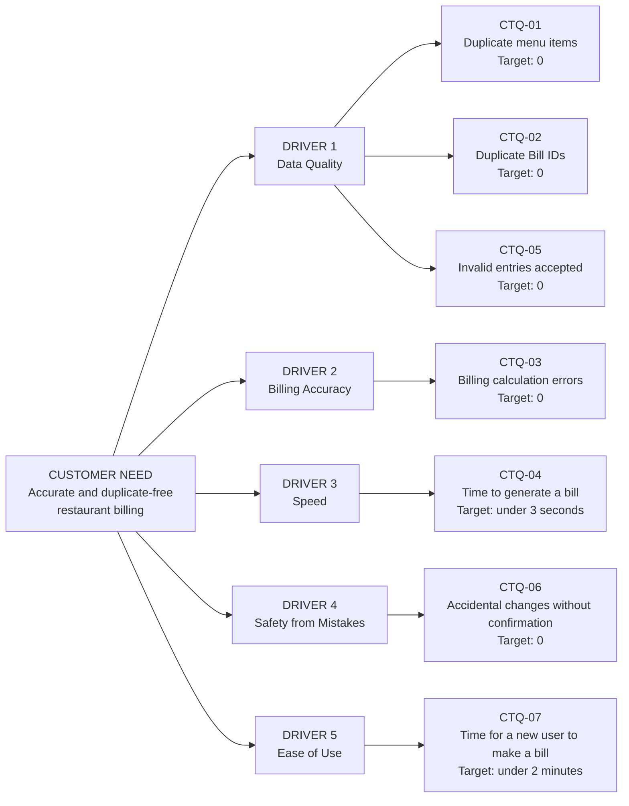

# CTQ Tree (Critical to Quality Tree)

**Project:** Restaurant Billing System
**Quality Goal:** Q06 - Reduce Duplicate Entries
**Student:** Priyanshu Negi (Roll No. 2410301054)

The CTQ Tree breaks the main customer need into drivers, and each driver into measurable CTQ parameters.

## 1. CTQ Tree Diagram

## 2. CTQ Tree Table

| Customer Need | Driver | CTQ ID | CTQ Parameter | Measurable Target | Q06 Feature that supports it |
|---|---|---|---|---|---|
| Accurate and duplicate-free billing | Data Quality | CTQ-01 | Duplicate menu items in database | 0 | Unique ID Constraints, Search Before Add |
| Accurate and duplicate-free billing | Data Quality | CTQ-02 | Duplicate Bill IDs | 0 | Unique ID Constraints |
| Accurate and duplicate-free billing | Data Quality | CTQ-05 | Invalid entries accepted | 0 | Pre-add Validation |
| Accurate and duplicate-free billing | Billing Accuracy | CTQ-03 | Calculation errors in subtotal, tax and total | 0 | Automatic calculation (no manual entry) |
| Accurate and duplicate-free billing | Speed | CTQ-04 | Time to generate one bill | Under 3 seconds | Not applicable |
| Accurate and duplicate-free billing | Safety from Mistakes | CTQ-06 | Add, update, delete or bill done without confirmation | 0 | Confirmation Dialogs |
| Accurate and duplicate-free billing | Ease of Use | CTQ-07 | Time for a new user to create a bill | Under 2 minutes | Clean dashboard and sidebar UI |

## 3. How each CTQ will be measured

| CTQ ID | Measurement method |
|---|---|
| CTQ-01 | Count of duplicate names found in the menu table, plus blocked attempts in the Duplicate Attempt Log |
| CTQ-02 | Check that every Bill ID in the bill history is unique |
| CTQ-03 | Compare the bill total with a manual calculation for sample orders |
| CTQ-04 | Stopwatch test while clicking Generate Bill |
| CTQ-05 | Try invalid names, categories and prices and count how many are accepted |
| CTQ-06 | Try add, update and delete and check that a confirmation always appears |
| CTQ-07 | Ask a new user to create a bill and note the time taken |