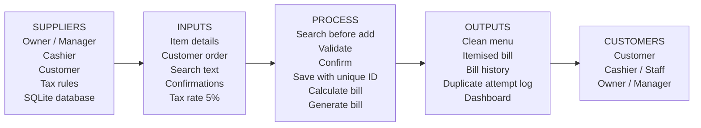

# SIPOC Process Map

**Project:** Restaurant Billing System
**Quality Goal:** Q06 - Reduce Duplicate Entries
**Student:** Priyanshu Negi (Roll No. 2410301054)

SIPOC maps the process from the people who supply data (Suppliers) to the people who receive the result (Customers).

## 1. SIPOC Table

| Suppliers | Inputs | Process | Outputs | Customers |
|---|---|---|---|---|
| Restaurant owner / manager | Menu item name, category and price | 1. Search the menu for the item (Search Before Add) | Clean menu with no duplicate items | Cashier / staff |
| Cashier / staff | Customer order (items and quantities) | 2. Validate name, category and price (Pre-add Validation) | Validated and confirmed menu records | Restaurant owner / manager |
| Customer | Search text and Yes / No confirmations | 3. Ask for confirmation, then save with a unique constraint | Itemised bill with subtotal, 5% tax and total | Customer |
| Government tax rules | Tax rate (5%) | 4. Select items and quantities for the order | Bill history with unique Bill IDs | Restaurant owner / manager |
| SQLite database | Existing menu and bill records | 5. Calculate subtotal, tax and total | Duplicate attempt log | Restaurant owner / manager |
| Python application (validators) | Validation rules (length, allowed characters, price range) | 6. Confirm and generate the bill with a unique Bill ID | Dashboard statistics (items, bills, revenue, duplicates blocked) | Restaurant owner / manager |

## 2. SIPOC Flow

## 3. Where Q06 acts in the process

| Q06 Feature | Process step | What it prevents |
|---|---|---|
| Search Before Add | Step 1 | Adding an item that already exists |
| Pre-add Validation | Step 2 | Invalid names, categories and prices entering the database |
| Confirmation Dialogs | Step 3 and Step 6 | Accidental adds, updates and bills |
| Unique ID Constraints | Step 3 and Step 6 | Duplicate menu items and duplicate Bill IDs |
| Duplicate Attempt Log | Step 3 | Hidden duplicate attempts (every blocked attempt is recorded) |

## 4. Process Boundaries

- **Start:** the owner or cashier opens the application and enters an item or an order.
- **End:** the item is stored in the menu, or the bill is saved in the bill history.
- **Out of scope:** online ordering, payment gateway, inventory and kitchen display.