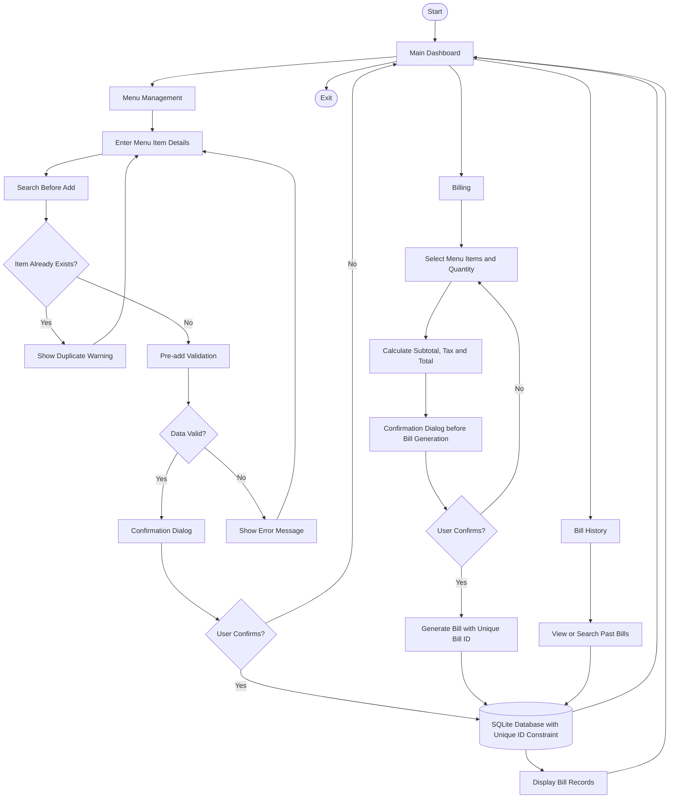

# System Architecture Flowchart

**Project:** Restaurant Billing System
**Quality Goal:** Q06 - Reduce Duplicate Entries

The flowchart below shows the main flow of the system. The duplicate-prevention checks (Search Before Add, Pre-add Validation, Confirmation Dialog and Unique ID) are part of the Q06 quality goal.

